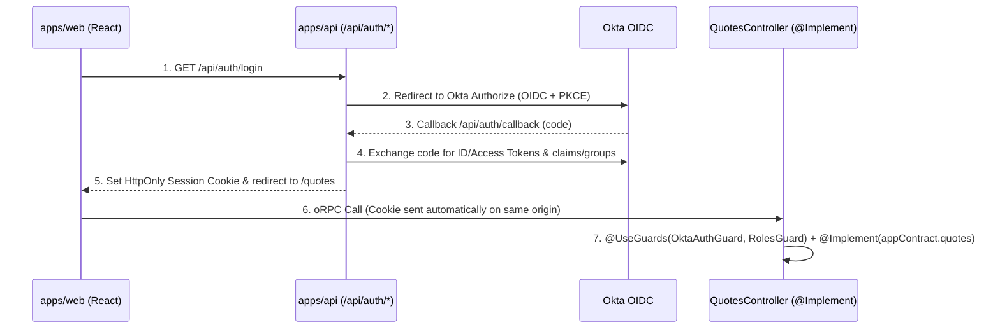
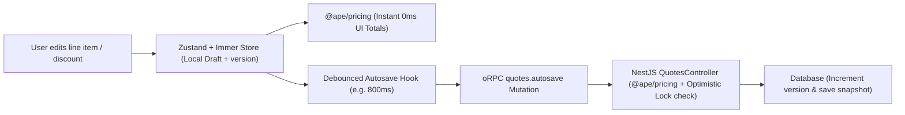

# Enterprise In-House CPQ — Architecture & Implementation Plan

This document serves as the blueprint for scaling the **AF-IRS-APE** reference monorepo into a production-grade in-house **CPQ (Configure, Price, Quote)** platform.

---

## 1. How This Reference Repo Maps to the Real CPQ System

Every package and boundary in this repository was designed to map 1-to-1 to a real CPQ architecture:

| Reference Workspace                       | CPQ Production Role                                                                                                                                                                  | Why This Boundary Matters in CPQ                                                                                                                                                                                                                                                             |
| :---------------------------------------- | :----------------------------------------------------------------------------------------------------------------------------------------------------------------------------------- | :------------------------------------------------------------------------------------------------------------------------------------------------------------------------------------------------------------------------------------------------------------------------------------------- |
| **`packages/shared` (`@ape/shared`)**     | Shared Zod v4 schemas, quote/line-item domain types, currency/math helpers, and configuration constraint schemas.                                                                    | Guarantees identical validation in the browser (`@tanstack/react-form`) and on the backend (`@ape/contract` + `@orpc/nest`).                                                                                                                                                                 |
| **`packages/pricing` (`@ape/pricing/*`)** | Pure, deterministic pricing & discounting engines versioned by subpath (`@ape/pricing/old`, `@ape/pricing/new`, or `/v1`, `/v2`).                                                    | **Web** runs the engine for instant `0ms` UI price previews while editing line items; **API** runs the exact same engine authoritatively before saving to DB or syncing to CRM. Subpath exports allow historical quotes locked to legacy pricing formulas to coexist safely with new quotes. |
| **`packages/contract` (`@ape/contract`)** | Pure contract-first API specification (`@orpc/contract`) with routes, inputs, outputs, and typed domain errors.                                                                      | Zero backend implementation or duplicate provider interfaces in the shared package. `apps/web` and `apps/api` both depend only on `@ape/contract`.                                                                                                                                           |
| **`apps/api`**                            | NestJS 12 backend with `@orpc/nest` (`@Implement` on standard NestJS `@Controller()` classes), Okta AuthN/AuthZ Guards, `@nestjs/drizzle`, CRM adapters, and `@nestjs/serve-static`. | Preserves 100% of NestJS's modular architecture, Guards, Interceptors, and Exception Filters while serving both `/api/*` and the React SPA on the same origin.                                                                                                                               |
| **`apps/web`**                            | React 19 + React Compiler SPA with TanStack Router, TanStack Query + `@orpc/tanstack-query`, TanStack Table v9, TanStack Form, and Zustand + Immer.                                  | Built for high-density data tables (line items, tiers, ramp deals), complex multi-step quote configuration forms, and local working-draft state.                                                                                                                                             |

---

## 2. Technology Stack & Library Decisions

### A. Core Stack (Already Installed & Configured in This Blueprint)

| Category                 | Technology                                 | Package(s)                                                                                     | Role in CPQ                                                                                                                           |
| :----------------------- | :----------------------------------------- | :--------------------------------------------------------------------------------------------- | :------------------------------------------------------------------------------------------------------------------------------------ |
| **Toolchain & Monorepo** | **Vite+ (`vp`)** + npm workspaces          | `vite-plus` (`Oxlint`, `tsgolint`, `Oxfmt`, `Vitest`, `tsdown`)                                | Unified task runner, caching, formatting, type-aware linting, bundler, and test runner.                                               |
| **Frontend Runtime**     | **React 19 + React Compiler**              | `react`, `react-dom`, `babel-plugin-react-compiler`                                            | Automatic memoization for complex quote tables and calculators without manual `useMemo`/`useCallback`.                                |
| **Routing**              | **TanStack Router**                        | `@tanstack/react-router`, `@tanstack/router-plugin`                                            | File-based, 100% type-safe routing, search-param validation (filters/tabs), and `useBlocker` for unsaved quote changes.               |
| **API Contract & RPC**   | **oRPC**                                   | `@orpc/contract`, `@orpc/nest`, `@orpc/client`, `@orpc/openapi-client`, `@orpc/tanstack-query` | Contract-first API (`@ape/contract`), native NestJS `@Controller()` integration, and TanStack Query `queryOptions`/`mutationOptions`. |
| **API Docs**             | **oRPC OpenAPI + Scalar**                  | `@orpc/openapi`, `@orpc/zod`                                                                   | Auto-generated OpenAPI 3.1.1 spec (`/docs/spec.json`) and interactive Scalar UI (`/docs`).                                            |
| **Server State**         | **TanStack Query v5**                      | `@tanstack/react-query`                                                                        | Caching, background refetching, optimistic updates, and request deduplication.                                                        |
| **Client / Draft State** | **Zustand v5 + Immer**                     | `zustand`, `immer`                                                                             | Local working copy of the active quote draft, undo/redo history, and multi-panel UI state.                                            |
| **Data Grids**           | **TanStack Table v9**                      | `@tanstack/react-table`                                                                        | Headless line-item configurator grid, multi-column sorting, grouping, and expandable bundle rows.                                     |
| **Forms**                | **TanStack Form**                          | `@tanstack/react-form`                                                                         | Type-safe forms validated directly with shared `@ape/shared` Zod v4 schemas.                                                          |
| **UI & Styling**         | **Tailwind CSS v4 + shadcn/ui + Radix UI** | `tailwindcss`, `radix-ui`, `lucide-react`, `class-variance-authority`                          | Accessible, customizable enterprise UI components.                                                                                    |
| **Backend Framework**    | **NestJS 12**                              | `@nestjs/core`, `@nestjs/common`, `@nestjs/platform-express`, `@nestjs/serve-static`           | Modular backend architecture, DI container, Guards (Okta/RBAC), Interceptors, and single-origin static SPA hosting.                   |
| **Database & ORM**       | **Drizzle ORM + Official NestJS Drizzle**  | `@nestjs/drizzle`, `drizzle-orm`, `drizzle-kit`, `better-sqlite3` (or `pg` in prod)            | Type-safe SQL queries, transactions, schema migrations, and `:memory:` test isolation.                                                |
| **Validation**           | **Zod v4**                                 | `zod`                                                                                          | Runtime schema validation shared across client forms, oRPC contracts, and backend services.                                           |

---

### B. Recommended Additions When Building the Full CPQ App (Add Only as Needed)

| Need in CPQ                                                                          | Recommendation                                                                     | Why This Choice (and What to Avoid)                                                                                                                                                                                                                                                                                                                                            |
| :----------------------------------------------------------------------------------- | :--------------------------------------------------------------------------------- | :----------------------------------------------------------------------------------------------------------------------------------------------------------------------------------------------------------------------------------------------------------------------------------------------------------------------------------------------------------------------------- |
| **Charts & Analytics** (Margin waterfall, discount distribution, ramp deal bars)     | **shadcn/ui Charts (`recharts`)** (`npx shadcn@latest add chart`)                  | **Avoid `@tanstack/react-charts`**: TanStack Charts has been stuck in an old unmaintained beta (`v3.0.0-beta.57`) and does not support React 19 properly. **shadcn/ui Charts** wraps `recharts` using your exact Tailwind v4 theme variables and works out of the box with zero custom styling.                                                                                |
| **Debounce / Autosave Timing** (Debouncing quote autosave & catalog search)          | **`use-debounce`** (or a 25-line custom hook wrapping **`@tanstack/react-pacer`**) | **`@tanstack/react-pacer`** (`useDebouncer`, `useQueuer`) is promising and actively built by TanStack, but is still `0.x` beta. For production safety today, either use `use-debounce` (rock-solid, supports `.flush()` on route leave and `.cancel()`) or wrap it inside a single `useDebouncedAutosave()` hook so you can swap to `@tanstack/react-pacer` later in one file. |
| **Range Sliders & Date Ranges** (Discount % range filters, contract start/end dates) | **shadcn/ui (`slider`, `calendar`, `popover`)**                                    | **No extra library needed.** You already have `radix-ui` installed. `shadcn add slider` natively supports dual-thumb ranges (`value={[min, max]}`), and `shadcn add calendar` (`react-day-picker`) natively supports date ranges (`mode="range"`).                                                                                                                             |
| **Large Table Virtualization** (Quotes with 200+ line items or 5,000+ SKU catalogs)  | **`@tanstack/react-virtual`**                                                      | Official, stable (`v3`) TanStack package that pairs directly with `@tanstack/react-table` to render only visible rows at 60fps.                                                                                                                                                                                                                                                |
| **Line-Item Drag & Drop** (Reordering quote rows & bundle sections)                  | **`@dnd-kit/core` + `@dnd-kit/sortable`**                                          | Works cleanly with `@tanstack/react-table` and keyboard accessibility.                                                                                                                                                                                                                                                                                                         |
| **Decimal / Currency Math** (Tiered discounting, proration, FX conversion)           | **Integer Cents + `decimal.js` (inside `@ape/pricing`)**                           | Prevents IEEE-754 floating-point errors (`0.1 + 0.2 !== 0.3`) when calculating multi-year ramp deals and percentage discounts.                                                                                                                                                                                                                                                 |
| **Quote PDF Export** (Customer-facing proposal PDF)                                  | **Playwright / Puppeteer in `apps/api`** or **`@react-pdf/renderer`**              | Renders approved quotes into signed PDFs for sending to customers or attaching to CRM opportunities.                                                                                                                                                                                                                                                                           |

---

## 3. Target Monorepo Structure for CPQ

```text
cpq-monorepo/
├── packages/
│   ├── shared/                   # @ape/shared: Zod schemas (Quote, LineItem, DiscountRule, UserSession)
│   ├── pricing/                  # @ape/pricing: Pure calculation engines
│   │   ├── src/old.ts            #   @ape/pricing/old (legacy quote pricing rules)
│   │   └── src/new.ts            #   @ape/pricing/new (current quote pricing rules)
│   └── contract/                 # @ape/contract: Pure @orpc/contract definitions
│       └── src/
│           ├── index.ts          #   appContract (populateContractRouterPaths)
│           └── contracts/        #   quotes.ts, catalog.ts, approvals.ts, crm.ts
├── apps/
│   ├── api/                      # NestJS 12 Backend (@orpc/nest)
│   │   └── src/
│   │       ├── auth/             #   Okta OIDC/JWT AuthGuard & @Roles() RBAC Guard
│   │       ├── db/               #   @nestjs/drizzle (PostgreSQL / SQLite) + schema & migrations
│   │       ├── quotes/           #   QuotesModule + QuotesController (@Implement(appContract.quotes))
│   │       ├── catalog/          #   CatalogModule + CatalogController (@Implement(appContract.catalog))
│   │       └── crm/              #   CrmModule + CrmController (@Implement(appContract.crm))
│   └── web/                      # React 19 Frontend
│       └── src/
│           ├── features/
│           │   ├── quotes/       #   Quote editor, autosave hook, line-item table, Zustand draft store
│           │   ├── catalog/      #   Product picker & bundle configurator
│           │   └── approvals/    #   Deal Desk approval workflows
│           ├── integrations/     #   oRPC (OpenAPILink) + TanStack Query setup
│           └── routes/           #   File-based routes with auth guards (beforeLoad)
└── vite.config.ts                # Unified Vite+ config (tasks, Oxlint + tsgolint, Oxfmt)
```

---

## 4. Core CPQ Pillars & How to Implement Them

### Pillar 1: Okta AuthN & Role-Based AuthZ with Native NestJS Guards + oRPC Context

Because `@orpc/nest` implements contracts directly on **real NestJS `@Controller()` classes** (`@Implement(appContract.quotes)`), you get the best of both worlds: standard NestJS `@UseGuards(OktaAuthGuard, RolesGuard)` **plus** type-safe `ORPCGlobalContext` inside handlers.



#### Step-by-step wiring:

1. **Use Standard NestJS Guards on Feature Controllers**:
   ```ts
   @Controller()
   @UseGuards(OktaAuthGuard, RolesGuard)
   export class ApprovalsController {
     constructor(private readonly approvalsService: ApprovalsService) {}

     @Roles("deal_desk", "admin")
     @Implement(appContract.approvals.approve)
     approve() {
       return implement(appContract.approvals.approve).handler(({ input, context }) => {
         return this.approvalsService.approveQuote(input, context.user);
       });
     }
   }
   ```
2. **Propagate Request/User Context via `ORPCModule.forRootAsync` in `AppModule`**:
   ```ts
   declare module "@orpc/nest" {
     interface ORPCGlobalContext {
       user?: AuthUser;
     }
   }
   ```

---

### Pillar 2: Dual-Execution Versioned Pricing Engine (`@ape/pricing`)

In CPQ, pricing logic is the most critical piece of IP. Keeping it in `packages/pricing` with subpath exports (`@ape/pricing/old`, `@ape/pricing/new`) gives you three major superpowers:

1. **Instant UI Responsiveness (`apps/web`)**:
   - When a Sales Rep changes a quantity, ramp year, or discount percentage in the quote table, `apps/web` runs `@ape/pricing/new` synchronously during render (or inside the Zustand action) so totals, margins, and approval thresholds update in `< 1ms` without waiting for a network round-trip.
2. **Server-Side Authority (`apps/api`)**:
   - Never trust client-submitted totals. When `quotes.autosave` or `quotes.submitForApproval` is called over oRPC, `QuotesService` in `apps/api` re-runs the exact same `@ape/pricing/*` function on the line-item inputs and stores the server-computed totals in the database.
3. **Version Pinning for Historical Quotes**:
   - Store a `pricingEngineVersion: "old" | "new"` column on each `quote` row in the database.
   - Quotes created under legacy pricing rules continue calling `@ape/pricing/old` when viewed or cloned, while new quotes use `@ape/pricing/new`—preventing silent recalculation drift on signed/historical quotes.

---

### Pillar 3: Quote Builder State & Reliable Autosave

A CPQ quote editor typically has dozens of fields, nested line-item configurations, and tiered discounts. Splitting state cleanly between **Zustand (+ Immer)** and **TanStack Query + oRPC** prevents race conditions and lost edits:



#### Key Patterns for CPQ Autosave:

- **Zustand + Immer for Working Draft (`useQuoteDraftStore`)**:
  - Holds the active quote being edited (`lineItems`, `discounts`, `customerMeta`, `dirty: boolean`, `lastSavedVersion: number`).
  - Every keystroke updates Zustand immediately so the table and `@ape/pricing` summary cards never lag.
- **Debounced Mutation + Flush on Navigation**:
  - A custom `useQuoteAutosave()` hook watches the Zustand draft, debounces changes by ~800ms, and calls `orpc.quotes.autosave.mutationOptions()`.
  - Use TanStack Router's `useBlocker` if a user tries to navigate away while `isSaving || isDirty` is true.
- **Typed Conflict Errors in `@ape/contract`**:
  - Include `version: z.number().int()` in `autosaveQuoteInputSchema` in `@ape/shared`, and declare `.errors({ CONFLICT: { data: z.object({ serverVersion: z.number() }) } })` on `appContract.quotes.autosave`.
  - In `apps/api`, update with `WHERE id = :id AND version = :version` and increment `version = version + 1`.
  - If 0 rows are updated (e.g., Deal Desk updated the quote in another tab), throw `errors.CONFLICT({ data: { serverVersion } })` so the UI prompts the user to reload or merge.

---

### Pillar 4: Scaling the Database (`@nestjs/drizzle`)

We already set up `@nestjs/drizzle` with `DatabaseModule` and `@InjectDrizzle()`. Moving from SQLite (`better-sqlite3`) to PostgreSQL (`pg`) for production requires **zero changes** to your NestJS architecture—only swapping the Drizzle dialect in `apps/api/src/db/`:

- **Core CPQ Schema (`apps/api/src/db/schema.ts`)**:
  - `quotes`: `id`, `opportunityId`, `ownerId`, `status` (`draft | in_review | approved | synced`), `pricingEngineVersion` (`old | new`), `version` (optimistic lock), `currency`, `netTotalCents`, `updatedAt`.
  - `quote_line_items`: `id`, `quoteId`, `skuId`, `quantity`, `unitListPriceCents`, `discountPercent`, `netPriceCents`, `configJson`.
  - `quote_approvals`: `id`, `quoteId`, `requiredRole`, `status`, `decidedBy`, `comment`, `decidedAt`.
  - `crm_sync_outbox`: `id`, `quoteId`, `payloadJson`, `status` (`pending | processing | completed | failed`), `attempts`, `lastError`.
- **Financial Precision**:
  - Store all monetary amounts as integer cents (or scaled integers / `numeric` strings) and validate them via `@ape/shared` schemas so floating-point rounding errors (`0.1 + 0.2`) never occur in `@ape/pricing`.

---

### Pillar 5: CRM Integration (Salesforce / HubSpot / Dynamics)

CRM APIs are external, rate-limited, and occasionally slow or unavailable.

1. **Modular NestJS Boundary (`CrmModule` in `apps/api`)**:
   - Define CRM endpoints in `@ape/contract` (`appContract.crm`) and implement them in `CrmController` inside `apps/api/src/crm/crm.controller.ts` injecting `CrmService`.
   - In unit and e2e tests, override `CrmService` via NestJS DI (`overrideProvider(CrmService)`) without hitting Salesforce/HubSpot sandboxes.
2. **Pull vs. Push Strategy**:
   - **Pull (Opportunity / Account Lookup)**: Use `orpc.crm.getOpportunity.queryOptions({ input: { id } })` with TanStack Query caching (`staleTime: 60_000`) when creating or linking a quote.
   - **Push (Sync Approved Quote to CRM)**: When a quote is approved, write both the `quote.status = 'approved'` update and a `crm_sync_outbox` record inside a single Drizzle database transaction (`this.db.transaction(...)`). Process the CRM push with retries and idempotency keys (`quoteId + version`) so network blips never leave the quote and CRM out of sync.

---

## 5. Recommended Implementation Roadmap

When you start building the real CPQ repository from this template, follow this sequence to keep every layer verifiable at each step:

- [ ] **Phase 1: Domain & Pricing Foundation (`packages/shared` & `packages/pricing`)**
  - Define `QuoteSchema`, `LineItemSchema`, `DiscountTierSchema`, and `ApprovalRuleSchema` in `@ape/shared`.
  - Implement deterministic line-item, bundle, and ramp-deal calculations in `@ape/pricing/new` (and legacy compatibility rules in `@ape/pricing/old`) with 100% Vitest unit test coverage.
- [ ] **Phase 2: Contract & Database Schema (`packages/contract` & `apps/api/src/db`)**
  - Define `appContract.quotes`, `appContract.catalog`, and `appContract.approvals` in `@ape/contract`.
  - Add `quotes`, `quote_line_items`, and `quote_approvals` tables to `apps/api/src/db/schema.ts`.
  - Implement `QuotesController` (`@Implement(appContract.quotes)`) and `QuotesService` with `version`-checked updates and server-side `@ape/pricing` recalculation.
- [ ] **Phase 3: Okta AuthN & NestJS Guards (`apps/api/src/auth`)**
  - Add Okta OIDC login/callback/logout routes in `apps/api` and `OktaAuthGuard` + `RolesGuard` on NestJS controllers.
- [ ] **Phase 4: Quote Editor UI, TanStack Table & Autosave (`apps/web`)**
  - Build the interactive line-item configurator using `@tanstack/react-table` + `@tanstack/react-form`.
  - Connect `useQuoteDraftStore` (Zustand + Immer) + `@ape/pricing` for instant client previews + debounced oRPC autosave mutation.
- [ ] **Phase 5: Approvals & CRM Sync (`apps/api/src/crm`)**
  - Add Deal Desk approval procedures (`quotes.submitForApproval`, `quotes.approve`, `quotes.reject`).
  - Implement `CrmModule` with transactional outbox sync to push approved quotes and line items to the CRM.
